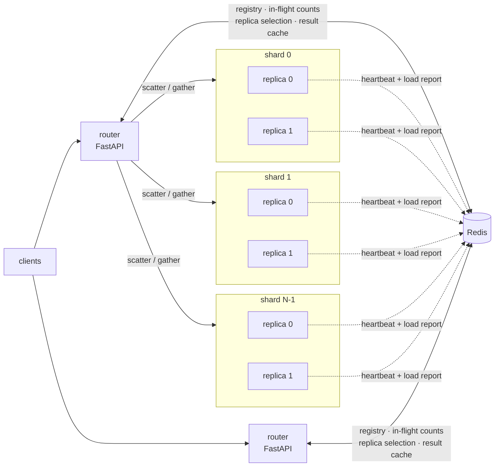

# Distributed Document Retrieval System with Network-Aware Optimization


A search engine that splits a 500,000-document index across FastAPI services
running in Docker, and routes and load-balances queries through Redis. It comes
with a benchmark suite that compares the distributed design against a single
centralized server as nodes are added and network conditions get worse.

## Highlights

- **Distributed architecture.** The index is split into shards, and each shard
  is served by one or more replica nodes. A router sends every query to all
  shards in parallel and merges their top results. A centralized, single-node
  deployment runs alongside on the same data for side-by-side comparison.
- **Request routing and load balancing with Redis.** Redis holds the service
  registry, cluster-wide in-flight request counts, and a query-result cache. The
  router chooses a replica for every shard with one atomic Redis call per query,
  using one of five strategies: random, round-robin, least-connections,
  power-of-two-choices, or latency-aware.
- **Network-aware optimizations.** Latency-aware routing on measured round-trip
  time, hedged requests when a shard call runs past the recent 95th-percentile
  response time, retries on another replica, admission control under overload,
  and partial results when a whole shard is down.
- **Fault tolerance.** If Redis goes down, routers keep serving from their own
  state (last-known topology, local load counts) and rejoin automatically when
  it returns. Nodes that keep failing are taken out of rotation by the router
  itself.
- **Benchmarking.** Throughput, latency, and scalability from 1 to 8 nodes;
  six simulated network profiles (ideal, LAN, data center, cross-zone, WAN,
  lossy); steady, Poisson, and bursty workloads; ranking quality compared with a
  centralized index; and a failure scenario that crashes Redis and a node under
  load.

## Architecture



## Key results

All services, Redis, and the load generator ran on one 4-vCPU machine, so the
relative comparisons matter more than the absolute numbers.

| Comparison | Result |
|---|---|
| Throughput, 4 shards vs. centralized | **2.3× higher** (454 vs. 194 queries/s) |
| p99 latency, bursty load on mixed hardware, latency-aware vs. round-robin routing | **12× lower** (164 vs. 2,024 ms) |
| p99 latency over a simulated WAN, with vs. without hedged requests | **2× lower** (131 vs. 262 ms) |
| p99 latency past capacity (600 queries/s offered), with vs. without admission control | **40× lower** (122 ms vs. 4.9 s) |
| Redis result cache on realistic, skewed query traffic | **4.7× higher** throughput, 89% hit rate |
| Queries answered during a 12-second Redis outage with a node crash, with vs. without failover | **100% vs. 0%** |


**Trade-offs the benchmarks surfaced**

- **More shards isn't always faster.** Past the machine's 4 cores, 8 shards were
  slower than 4. Adding replicas instead (2 shards × 2 replicas) gave the best
  throughput, 552 queries/s.
- **Distribution amplifies tail latency on bad networks.** A query waits for its
  slowest shard, so over a WAN the distributed p95 was 2.3× the centralized one.
  Hedged requests brought it back to roughly centralized levels.
- **Hedging fits network-driven tails, not CPU-driven ones.** On fast networks,
  the duplicate requests added load and made p99 slightly worse (35 → 42 ms).
- **Exact ranking costs a round trip.** Collecting global term statistics first
  makes distributed results identical to the centralized index, at +12 ms in a
  data center and +56 ms over a WAN.
- **Coordination shouldn't be a single point of failure.** With Redis on the
  request path, its outage failed every query. Failing open on local state kept
  every query answered at unchanged median latency, but it only works because
  each router's shared load counts repair themselves when Redis returns.

Full analysis: [docs/BENCHMARKS.md](docs/BENCHMARKS.md) · All tables:
[results/RESULTS.md](results/RESULTS.md)

## Quick start

**Docker.** 4 shards × 2 replicas, plus a centralized node for comparison:

```bash
python docker/gen_compose.py --shards 4 --replicas 2 > docker-compose.yml
docker compose up -d --build --wait
curl -s 'localhost:8080/search?q=dairkdark+geasjil+socam&k=5'   # port 8081 = centralized
```

**Without Docker** (needs `redis-server` on your PATH):

```bash
pip install -r requirements-dev.txt
python -m ddr.corpus build                        # generates the corpus (~8 s)
python -m bench.cluster --shards 4 --replicas 2   # starts Redis, nodes, and router
```

**Benchmarks and tests:**

```bash
python -m bench.run_benchmarks && python -m bench.plot   # ~20 min, writes results/
pytest -q                                                # 67 unit and end-to-end tests
```

## Project structure

```
ddr/       corpus generator, BM25 shard index, load balancer, Redis registry,
           network simulator, node and router services
bench/     local cluster launcher, load generator, benchmark suite, charts
docker/    Dockerfile, Compose generator for any shards × replicas layout, tc-netem helper
docs/      design notes, API reference, benchmark analysis
tests/     unit and end-to-end tests
results/   benchmark data, tables, and charts
```

## Documentation

- [Design and API](docs/DESIGN.md): how each component works, the routing
  optimizations, configuration, and endpoints
- [Benchmarks](docs/BENCHMARKS.md): methodology, every experiment, and takeaways
