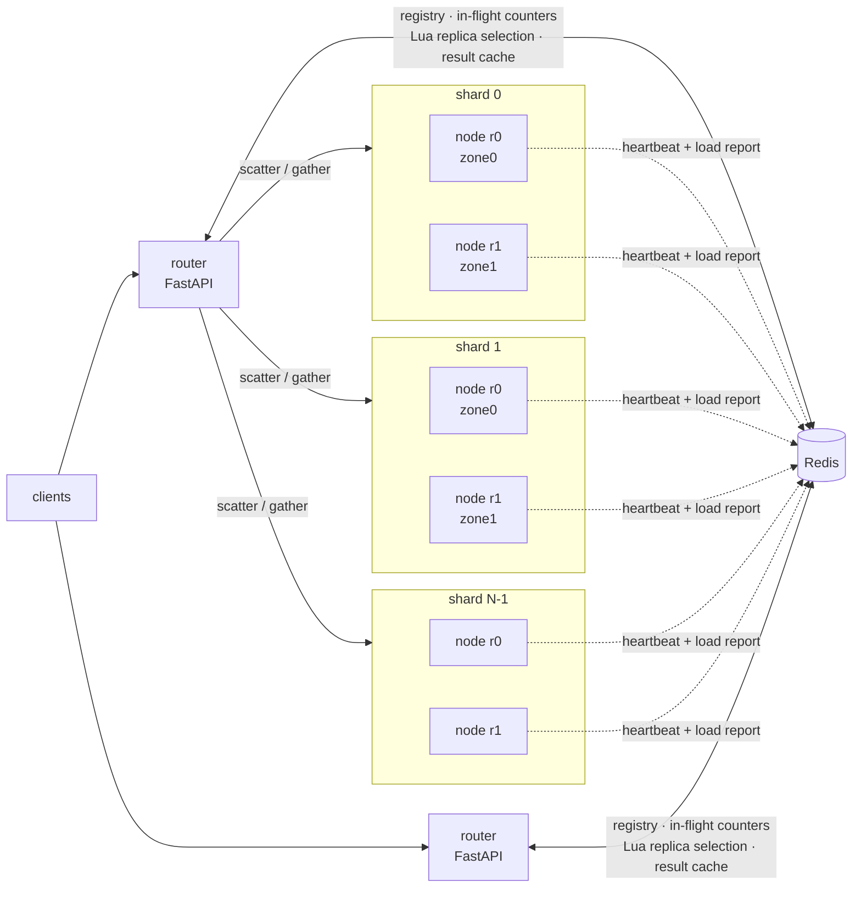
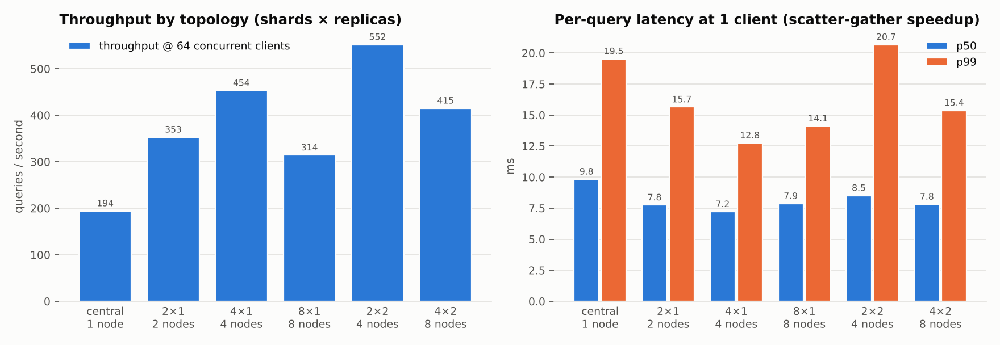
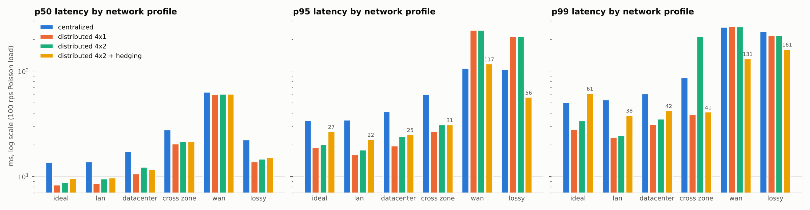
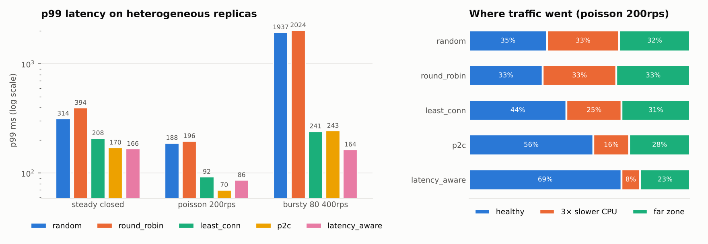
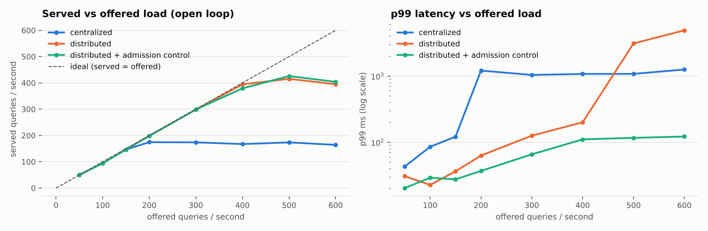
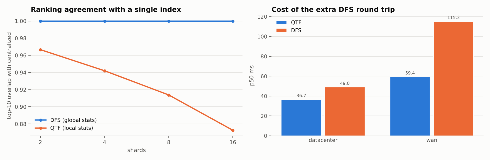

# Distributed Document Retrieval System with Network-Aware Optimization

A sharded, replicated full-text search system built from **FastAPI** services in
**Docker**, with **Redis** for service discovery, load-aware request routing and
result caching. It runs a centralized and a distributed deployment side by side
over identical data, so you can measure how throughput, latency, and ranking
quality trade off as nodes are added and network conditions get worse.



## How it works

| Component | File | What it does |
|---|---|---|
| Corpus | [`ddr/corpus.py`](ddr/corpus.py) | Deterministic synthetic corpus (default 500k docs / 66M tokens): Zipf vocabulary, topical documents, log-normal lengths. Stored as memory-mapped `.npy` so co-located nodes share one copy. |
| Index | [`ddr/index.py`](ddr/index.py) | Vectorised BM25 inverted index over one hash partition (`doc_id % num_shards`). Supports **local** statistics (query-then-fetch) or **global** statistics (DFS) passed in by the router. |
| Shard node | [`ddr/node/app.py`](ddr/node/app.py) | FastAPI service owning one shard. It registers in Redis, sends a heartbeat every second with its load (in-flight requests, EWMA service time), and can be reconfigured at runtime (`/admin/netem`) for network and hardware simulation. |
| Router | [`ddr/router/app.py`](ddr/router/app.py) | Scatter-gather over shards: Redis cache, then (optional) DFS stats round, then one replica per shard, then top-k merge. Adds **hedged requests**, **retry on another replica**, and **partial results** when a whole shard is down. |
| Load balancer | [`ddr/balancer.py`](ddr/balancer.py) | `random`, `round_robin`, `least_conn`, `p2c`, `latency_aware`. Selection and the in-flight increment run **atomically in one Redis Lua call for all shards of a query**, so many routers share one view of load without herding. |
| Registry | [`ddr/registry.py`](ddr/registry.py) | Node table and TTL heartbeats in Redis. A node whose heartbeat expires drops out of routing within 3 s. |
| Network simulator | [`ddr/netsim.py`](ddr/netsim.py) | Per-node delay, jitter, packet loss (modelled as a TCP RTO), bandwidth, and fault injection. Named profiles: `ideal`, `lan`, `datacenter`, `cross_zone`, `wan`, `lossy`. Kernel `tc netem` is also available in Docker ([`docker/netem.sh`](docker/netem.sh)). |

### Network-aware optimizations

* **Latency-aware replica selection.** Picks the replica that minimises
  `EWMA(RTT) × (in-flight + 1)`, which is the expected completion time. RTT is
  measured *by the router*, so it covers network distance, jitter and loss as
  well as server load. Errors add a latency penalty, and 2% of picks explore so
  a recovered replica can earn traffic back.
* **Atomic, batched Redis routing.** One Lua call chooses a replica for every
  shard and increments its in-flight count. Completions are coalesced, so all
  decrements from one event-loop tick go out in a single pipeline. Routing costs
  about two Redis round trips per query whatever the shard count, and concurrent
  routers can't all pick the same "least loaded" node.
* **Adaptive hedging** (`HEDGE_MS=-1`). If a shard hasn't answered by the
  rolling **p95** of recent shard RTTs, the router sends the same request to a
  second replica and keeps whichever answer arrives first. Only about 5% of
  calls get duplicated, and the trigger follows the network on its own: about
  3 ms in a data center, about 50 ms over a WAN.
* **Retries and graceful degradation.** A failed replica is retried on another
  replica. If every replica of a shard is down, the router returns `partial: true`
  results instead of an error, and partial results are never cached.
* **Admission control** (`MAX_INFLIGHT`). Once a router has this many queries
  in flight, it rejects new ones right away with `503 Retry-After` instead of
  queueing them. Past saturation, extra queueing only makes every query slower
  until requests time out, so goodput collapses. Shedding the excess keeps
  goodput at capacity and latency bounded.
* **Redis result cache.** Keyed on normalised query terms, mode, and k. It
  handles the head of a Zipf query distribution without touching the shards.

## Quick start

### Docker Compose

```bash
python docker/gen_compose.py --shards 4 --replicas 2 > docker-compose.yml   # any S x R topology
docker compose up -d --build --wait
```

That starts Redis, 8 distributed shard nodes behind `router-distributed`
(port **8080**), and one full-index node behind `router-centralized` (port **8081**).

```bash
curl -s 'localhost:8080/search?q=dairkdark+geasjil+socam&k=5' | jq '.took_ms, .nodes, .results[0]'
curl -s 'localhost:8080/topology' | jq        # live shards/replicas + load reports from Redis
curl -s 'localhost:8080/metrics'  | jq        # per-node EWMA RTT, hedges, retries, cache hits

# degrade one replica's link and watch latency_aware route around it
curl -s -X PUT localhost:8080/admin/netem -H 'content-type: application/json' \
     -d '{"nodes":["dist-s0r0"],"conditions":{"profile":"wan"}}'

# or use kernel-level netem inside a container
docker compose exec dist-s0r1 netem.sh 20ms 5ms 1%
```

Add `--far-zone-profile cross_zone` to `gen_compose.py` to put the last replica of every shard behind a slower link.

### Local processes (no Docker)

```bash
pip install -r requirements-dev.txt          # also needs redis-server on PATH
python -m ddr.corpus build                   # ~8 s, writes data/corpus
python -m bench.cluster --shards 4 --replicas 2
```

## API

| Endpoint | Description |
|---|---|
| `GET /search?q=&k=10` | Optional `strategy=`, `mode=qtf\|dfs`, `hedge_ms=` (−1 = adaptive), `cache=false` |
| `GET /topology` | Alive nodes per shard, with each node's latest load report |
| `GET /metrics` | Router counters, per-node EWMA RTT and errors, Redis in-flight counts, current adaptive hedge threshold |
| `GET /health` | `ok`, or `degraded` when a shard has no live replica |
| `PUT /admin/config` | Change `strategy`, `mode`, `hedge_ms`, `max_attempts`, `shard_timeout_ms`, `cache_ttl_s`, `max_inflight` at runtime |
| `PUT /admin/netem` | Apply network conditions (`profile`, `delay_ms`, `jitter_ms`, `loss`, `bandwidth_mbps`, `fail_rate`, `cpu_slowdown`) to some or all nodes |
| `POST /admin/cache/flush` | Clear the result cache |

Nodes expose `POST /search`, `POST /termstats`, `GET /info`, `GET/PUT /admin/netem`.

## Benchmarks

```bash
python -m bench.run_benchmarks            # all experiments, ~20 min → results/results.json
python -m bench.plot                      # → results/plots/*.png + results/RESULTS.md
python -m bench.run_benchmarks -e balancing --quick
python -m bench.loadgen http://localhost:8080 --concurrency 32 --duration 10 --zipf 1.1
```

The load generator supports **closed-loop** runs (N concurrent users) and
**open-loop** runs (Poisson arrivals, constant or time-varying rate). In
open-loop runs, latency is measured from each request's *scheduled* send time,
so queueing delay isn't hidden by coordinated omission.

### Results

All of these numbers come from one run of `python -m bench.run_benchmarks` on a
**4-vCPU** host, with every service, Redis, and the load generator on the same
machine. Absolute throughput is therefore limited by that host; the relative
comparisons are what carry over. The corpus has 500k documents and 66M tokens,
and each data point is 8 s of measurement after a warm-up. Full tables are in
[`results/RESULTS.md`](results/RESULTS.md) and raw data in
[`results/results.json`](results/results.json).

#### 1. Scaling: distribution pays off until you run out of cores



| topology (shards×replicas) | central 1×1 | 2×1 | 4×1 | 8×1 | 2×2 | 4×2 |
|---|---:|---:|---:|---:|---:|---:|
| throughput @ 64 clients (rps) | 194 | 353 | 454 | 314 | **552** | 415 |
| p50 latency @ 1 client (ms) | 9.8 | 7.8 | **7.2** | 7.9 | 8.5 | 7.8 |

* Splitting the index 4 ways gives **2.3× throughput** and cuts single-query
  latency by about 26%, because each shard scans a quarter of the postings in
  parallel.
* Past the core count, more shards *hurt*: 8×1 is slower than 4×1. Each extra
  shard adds router fan-out and merge work without adding CPU.
  **Replication scaled better than finer sharding** here (2×2 at 552 rps is the
  best result). A query costs one sub-request per *shard*, not per replica.
* Single-query latency improves less than throughput because fixed per-hop
  costs (HTTP plus about 2 ms of simulated data-center RTT) don't parallelise.

#### 2. Network conditions: fan-out amplifies the tail, and hedging cancels it



At 100 rps of open-loop Poisson load (about half of centralized capacity):

| profile | centralized p99 | distributed 4×1 p99 | 4×2 p99 | 4×2 + adaptive hedging p99 |
|---|---:|---:|---:|---:|
| datacenter (1 ms ± 0.5) | 61 | **31** | 35 | 42 |
| cross-zone (5 ms ± 2, 0.1% loss) | 86 | 38 | 213 | **41** |
| WAN (20 ms ± 8, 1% loss) | 261 | 264 | 262 | **131** |
| lossy (2 ms ± 1, 3% loss) | 237 | 216 | 218 | **161** (p95: 214 → **56**) |

* On a good network, distributed wins at every percentile (about half the
  centralized p99).
* On a bad network, distribution **amplifies tail latency**. A query has to
  wait for the *slowest* of N shard calls, so a per-call loss rate *p* becomes
  roughly a 1-(1-p)<sup>2N</sup> chance per query. Under WAN conditions the
  distributed p95 is **2.3× the centralized p95** (244 vs 106 ms), even though
  the medians are equal.
* **Adaptive hedging** sends a duplicate to the other replica once a call
  passes the rolling p95. It halves WAN p99 (262 → 131 ms) and cuts p95 under
  loss by 74% (214 → 56 ms), duplicating only about 5% of shard calls. The
  trigger follows the network on its own: about 12 ms in a data center, about
  66 ms over a WAN.
* Hedging isn't free. When the tail comes from **CPU queueing** (fast
  networks), duplicate work makes p99 slightly *worse* (35 → 42 ms). It's the
  right tool for network-driven tails, not load-driven ones.

#### 3. Load balancing: network-aware selection on heterogeneous replicas



Topology: 2 shards × 3 replicas. In each shard, one replica is healthy, one
runs on **3× slower hardware**, and one sits behind a **cross-zone link**.

| strategy | steady (closed loop) rps / p99 | Poisson 200 rps p99 | bursty 80↔400 rps p99 |
|---|---:|---:|---:|
| random | 227 / 314 | 188 | 1937 |
| round_robin | 227 / 394 | 196 | 2024 |
| least_conn (Redis) | 434 / 208 | 92 | 241 |
| p2c | **459** / 170 | **70** | 243 |
| latency_aware (Redis + EWMA RTT) | 435 / **166** | 86 | **164** |

* Load-oblivious strategies split traffic evenly, so the slow replica sets the
  pace for everyone. Under bursts their queues grow to seconds.
* Strategies that use the **shared Redis in-flight counters** nearly double
  throughput (227 → 435–459 rps). Under bursts they cut p99 by about
  **12×** (2,024 → 164 ms for latency-aware).
* `latency_aware` routes only 8% of traffic to the slow node, down from 33%.
  It also learns that the far-zone replica is still worth using when the
  healthy one is queued. It has the best p99 under bursty load; `p2c` is about
  as good under steady load and does less work per pick.

#### 4. Saturation: admission control prevents latency collapse



* Centralized saturates at about **175 rps**. Past that, its queries miss the
  2 s shard timeout and come back partial; those don't count as goodput here.
* Distributed 4×1 sustains about **415 rps**. Without admission control,
  overload drives its p99 to **4.9 s**, and 13% of requests time out on the
  client at 600 rps offered.
* With **admission control** (`MAX_INFLIGHT=32`), goodput stays the same
  (~404–426 rps), but the excess is rejected immediately. p99 never goes above
  **122 ms** at any load level, **40× lower** than without it at 600 rps.

#### 5. Redis result cache under realistic (Zipf) query popularity

| query popularity | cache | throughput (rps) | p50 (ms) | hit rate |
|---|---|---:|---:|---:|
| uniform | off | 421 | 76 | — |
| uniform | on | 769 | 35 | 50% |
| Zipf s=1.1 | off | 456 | 71 | — |
| Zipf s=1.1 | on | **2,126** | **9.4** | 89% |

With head-heavy traffic, the cache gives **4.7× throughput and 7.5× lower median latency**.

#### 6. Ranking quality: local vs global statistics



* **Query-then-fetch** scores each shard with its own document frequencies. Its
  top-10 overlap with the centralized index drops as shards are added (96.7% at
  2 shards, 87.3% at 16), and the exact top-10 order matches only 2–32% of the
  time.
* **DFS** first collects term statistics from every shard. It reproduces the
  centralized ranking **exactly (100%)** at any shard count. The integration
  tests also check this through the real router.
* DFS costs one extra fan-out round trip: +12 ms p50 in a data center,
  but +56 ms (about 2×) over a WAN. That makes it a clear network-dependent
  trade-off between exact ranking and latency.

#### Takeaways

1. **Distribute for throughput, replicate for headroom.** Sharding beyond the
   available cores adds coordination cost without adding capacity.
2. **A distributed system is only as fast as its slowest shard call.** As the
   network gets worse, a centralized design's simplicity becomes an advantage,
   unless tail-tolerance (hedging, replica choice) is built into the router.
3. **Load balancing needs shared, current load data.** Redis-backed in-flight
   counters with atomic Lua selection turned a 2-second bursty p99 into 164 ms
   on mixed hardware.
4. **Overload has to be handled explicitly.** Admission control keeps the same
   goodput at a fraction of the latency.
5. **Cache the head of the distribution.** Real query traffic is skewed, and
   one Redis lookup can replace the whole fan-out.

## Tests

```bash
pytest -q     # 49 tests: index correctness, netsim statistics, Lua balancer semantics, end-to-end cluster
```

The end-to-end tests start real router and node processes plus Redis. They
check that **DFS results through the router match a centralized index exactly**,
that traffic fails over to a healthy replica, that a dead shard yields partial
results, and that hedging hides a slow replica.

## Repository layout

```
ddr/            corpus, BM25 index, netsim, registry, balancer, node + router services
bench/          local cluster launcher, load generator, benchmark suite, plotting
docker/         Dockerfile, compose generator, tc-netem helper
tests/          unit + integration tests
results/        benchmark output (results.json, RESULTS.md, plots/)
```
