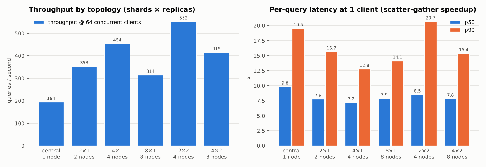
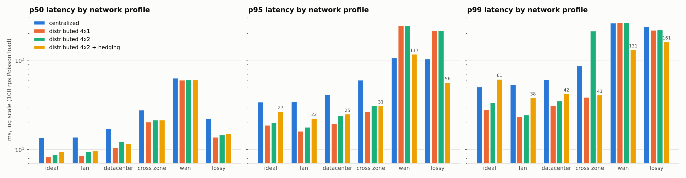
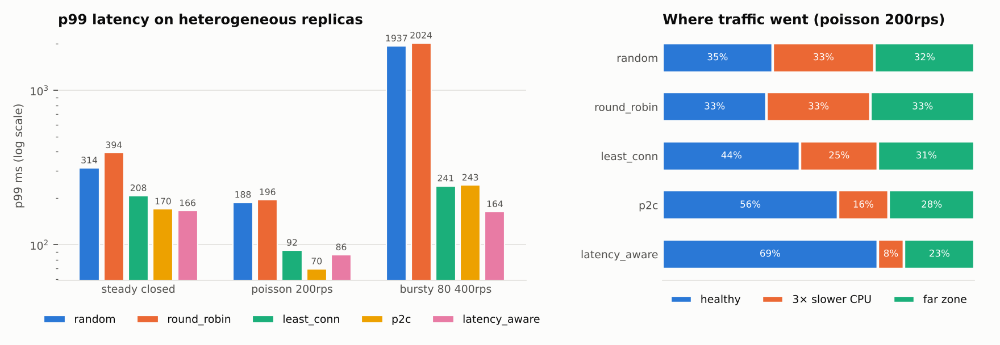
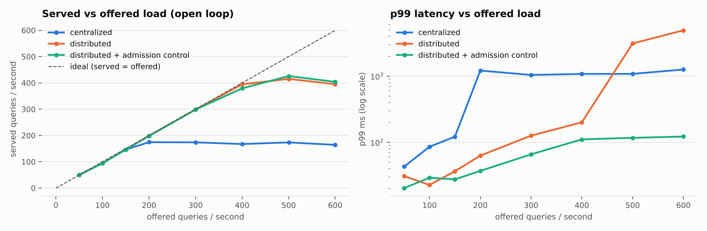
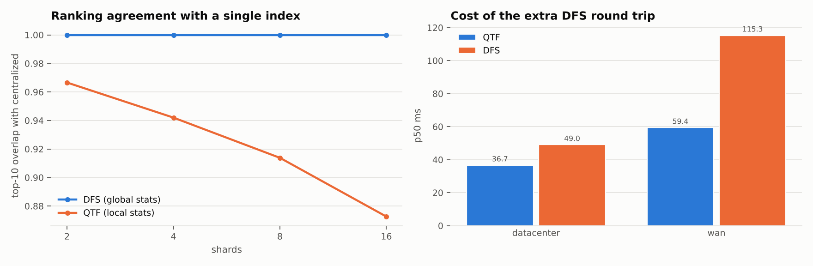
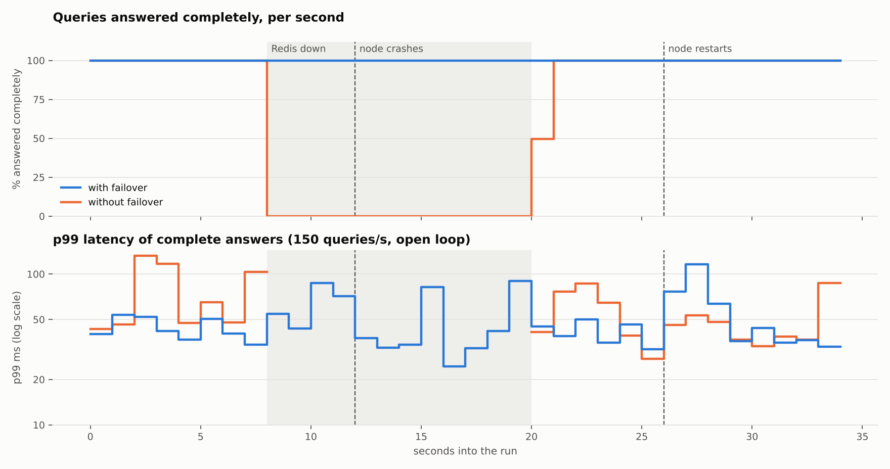

# Benchmarks

What was measured, how, and what it showed. Sections 1–6 come from one full run
of `python -m bench.run_benchmarks`. Section 7 (failure handling) was added later
and ran on its own, on a different machine of the same size (4 vCPUs), so its
numbers are best compared within that section. On that machine, the code before
and after the failover changes ran side by side, interleaved, with no
measurable routing overhead: throughput differed by −3% to +6% across six
configurations, less than repeated runs of the same code differed (up to 14%).
All tables are in [results/RESULTS.md](../results/RESULTS.md), and the raw data
is in [results/results.json](../results/results.json).

## Methodology

- **Host.** One 4-vCPU machine running every service, Redis, and the load
  generator. Absolute throughput is limited by that host; the relative
  comparisons are what carry over.
- **Data.** A synthetic corpus of 500,000 documents (66M tokens, 30,000-word
  vocabulary, 400 topics) and a pool of 5,000 topical keyword queries. The same
  seed produces identical data on every node.
- **Clusters.** Each topology starts fresh as local processes, with the same
  services and settings as the Docker deployment. A new cluster gets 3 s of
  unmeasured load first, and each data point is 8 s of measurement after a
  1.5 s warm-up.
- **Load generator.** Closed-loop runs keep N clients busy and show maximum
  throughput. Open-loop runs send Poisson arrivals at a fixed or time-varying
  rate, and measure latency from each request's *scheduled* send time, so
  queueing delay isn't hidden (no coordinated omission).
- **Goodput.** Throughput counts only complete answers. Partial results, shed
  requests, and errors are reported separately.
- **Network conditions** are applied to the nodes at runtime; the profiles are
  listed in [DESIGN.md](DESIGN.md#network-profiles).

## 1. Scaling: distribution pays off until you run out of cores



| topology (shards × replicas) | central 1×1 | 2×1 | 4×1 | 8×1 | 2×2 | 4×2 |
|---|---:|---:|---:|---:|---:|---:|
| throughput @ 64 clients (queries/s) | 194 | 353 | 454 | 314 | **552** | 415 |
| p50 latency @ 1 client (ms) | 9.8 | 7.8 | **7.2** | 7.9 | 8.5 | 7.8 |

- Splitting the index 4 ways gives **2.3× throughput** and cuts single-query
  latency by about 26%, because each shard scans a quarter of the postings in
  parallel.
- Past the core count, more shards *hurt*: 8×1 is slower than 4×1. Each extra
  shard adds router fan-out and merge work without adding CPU.
  **Replication scaled better than finer sharding** here (2×2 at 552 queries/s
  is the best result), because a query costs one sub-request per *shard*, not
  per replica.
- Single-query latency improves less than throughput because fixed per-hop
  costs (HTTP plus about 2 ms of simulated data-center round trip) don't
  parallelise.

## 2. Network conditions: fan-out amplifies the tail, and hedging cancels it



At 100 queries/s of open-loop Poisson load (about half of centralized capacity),
p99 latency in ms:

| profile | centralized | distributed 4×1 | distributed 4×2 | 4×2 + adaptive hedging |
|---|---:|---:|---:|---:|
| datacenter | 61 | **31** | 35 | 42 |
| cross-zone | 86 | 38 | 213 | **41** |
| WAN | 261 | 264 | 262 | **131** |
| lossy | 237 | 216 | 218 | **161** (p95: 214 → **56**) |

- On a good network, distributed wins at every percentile, with about half the
  centralized p99.
- On a bad network, distribution **amplifies tail latency**. A query has to wait
  for the *slowest* of N shard calls, so a per-call loss rate *p* becomes
  roughly a 1-(1-p)<sup>2N</sup> chance per query. Under WAN conditions the
  distributed p95 is **2.3× the centralized p95** (244 vs. 106 ms), even though
  the medians are equal.
- **Adaptive hedging** sends a duplicate to the other replica once a call passes
  the rolling p95. It halves WAN p99 (262 → 131 ms) and cuts p95 under loss by
  74% (214 → 56 ms), while duplicating only about 5% of shard calls. The trigger
  follows the network on its own: about 12 ms in the data center, about 66 ms
  over the WAN.
- Hedging isn't free. When the tail comes from **CPU queueing** (fast networks),
  the duplicate work makes p99 slightly *worse* (35 → 42 ms). It's the right
  tool for network-driven tails, not load-driven ones.

## 3. Load balancing: network-aware selection on heterogeneous replicas



Topology: 2 shards × 3 replicas. In each shard, one replica is healthy, one runs
on **3× slower hardware**, and one sits behind a **cross-zone link**.

| strategy | steady (closed loop) queries/s / p99 ms | Poisson 200/s p99 ms | bursty 80↔400/s p99 ms |
|---|---:|---:|---:|
| random | 227 / 314 | 188 | 1,937 |
| round_robin | 227 / 394 | 196 | 2,024 |
| least_conn (Redis) | 434 / 208 | 92 | 241 |
| p2c | **459** / 170 | **70** | 243 |
| latency_aware (Redis + EWMA RTT) | 435 / **166** | 86 | **164** |

- Load-oblivious strategies split traffic evenly, so the slow replica sets the
  pace for everyone. Under bursts their queues grow to seconds.
- Strategies that use the **shared Redis in-flight counts** nearly double
  throughput (227 → 435–459 queries/s). Under bursts they cut p99 by about
  **12×** (2,024 → 164 ms for latency-aware).
- `latency_aware` sends only 8% of traffic to the slow replica, down from 33%.
  It also learns that the far-zone replica is still worth using when the healthy
  one is queued. It has the best p99 under bursty load; `p2c` is about as good
  under steady load and does less work per pick.

## 4. Saturation: admission control prevents latency collapse



- Centralized saturates at about **175 queries/s**. Past that, its queries miss
  the 2 s shard timeout and come back partial, which doesn't count as goodput.
- Distributed 4×1 sustains about **415 queries/s**. Without admission control,
  overload drives its p99 to **4.9 s**, and 13% of requests time out on the
  client at 600 queries/s offered.
- With **admission control** (`MAX_INFLIGHT=32`), goodput stays the same
  (about 404–426 queries/s), but the excess is rejected immediately. p99 never
  goes above **122 ms** at any load level, **40× lower** than without it at
  600 queries/s.

## 5. Redis result cache under realistic (Zipf) query popularity

| query popularity | cache | throughput (queries/s) | p50 (ms) | hit rate |
|---|---|---:|---:|---:|
| uniform | off | 421 | 76 | — |
| uniform | on | 769 | 35 | 50% |
| Zipf s=1.1 | off | 456 | 71 | — |
| Zipf s=1.1 | on | **2,126** | **9.4** | 89% |

With head-heavy traffic, the cache gives **4.7× throughput and 7.5× lower median
latency**.

## 6. Ranking quality: local vs. global statistics



- **Query-then-fetch** scores each shard with its own document frequencies. Its
  top-10 overlap with the centralized index drops as shards are added (96.7% at
  2 shards, 87.3% at 16), and the exact top-10 order matches only 2–32% of the
  time.
- **DFS** first collects term statistics from every shard. It reproduces the
  centralized ranking **exactly (100%)** at any shard count; the end-to-end
  tests also check this through the real router.
- DFS costs one extra fan-out round trip: +12 ms p50 in the data center, but
  +56 ms (about 2×) over the WAN. That makes it a network-dependent trade-off
  between exact ranking and latency.

## 7. Failure handling: a Redis outage and a node crash



Setup: 4 shards × 2 replicas, latency-aware routing, 150 queries/s of open-loop
Poisson load, data-center network. At 8 s Redis crashes; at 12 s a node crashes
while Redis is still down; at 20 s Redis restarts with no data; at 26 s the node
restarts. The same scenario runs against a router that fails closed
(`REDIS_FAILOVER=0`, the behaviour before failover existed) and one that fails
open.

| phase | with failover: answered completely | p50 ms | without failover: answered completely | p50 ms |
|---|---:|---:|---:|---:|
| steady state (0–8 s) | 100% | 15.8 | 100% | 19.2 |
| Redis down (8–12 s) | **100%** | 15.3 | **0%** | — |
| Redis down, node crashed (12–20 s) | **100%** | 13.2 | **0%** | — |
| Redis back, node still down (20–26 s) | 100% | 15.1 | 90.6% | 15.2 |
| node restarted (26–34 s) | 100% | 18.8 | 100% | 17.5 |
| whole run | **100%** | 15.4 | 62.7% | 17.3 |

- **Without failover, every query fails for the whole 12 s outage.** Redis sits
  on the request path (shared load counts, cache), so its errors become HTTP
  500s. Recovery then takes about another second, because the restarted Redis
  is empty until every node has re-registered.
- **With failover, every query in the run was answered completely.** The router
  switched to degraded mode on the first failed Redis call and served 1,821
  queries from local state. It was back on shared state within a fraction of a
  second of Redis returning, so its time in degraded mode (12.0 s) matched the
  outage.
- **The router routed around the crashed node without help from the
  registry.** The crash cost 6 retried shard calls in total: the node was
  ejected after its first failures, and single trial requests kept it out until
  it left the topology.
- **Latency was unaffected.** Median latency per second stayed at 12–16 ms
  during the outage, against 14–18 ms before it, and the node crash caused no
  visible spike. Both runs slow down for 2–3 s when the node restarts, because
  building its index competes for the host's 4 cores.

## Takeaways

1. **Distribute for throughput, replicate for headroom.** Sharding beyond the
   available cores adds coordination cost without adding capacity.
2. **A distributed system is only as fast as its slowest shard call.** As the
   network gets worse, a centralized design's simplicity becomes an advantage,
   unless the router is built to tolerate tail latency (hedging, replica
   choice).
3. **Load balancing needs shared, current load data.** Redis-backed in-flight
   counts with atomic Lua selection turned a 2-second bursty p99 into 164 ms on
   mixed hardware.
4. **Overload has to be handled explicitly.** Admission control keeps the same
   goodput at a fraction of the latency.
5. **Cache the head of the distribution.** Real query traffic is skewed, and one
   Redis lookup can replace the whole fan-out.
6. **Keep the coordination layer off the critical path.** Redis holds no search
   data, so the router fails open on local state instead of failing every query.
   Making the shared load counts repair themselves is what lets it rejoin
   cleanly afterwards.

## Reproducing

```bash
python -m ddr.corpus build                               # once, ~8 s
python -m bench.run_benchmarks                           # all experiments, ~20 min → results/results.json
python -m bench.plot                                     # → results/plots/*.png and results/RESULTS.md
python -m bench.run_benchmarks -e balancing --quick      # one experiment, short run
python -m bench.loadgen http://localhost:8080 --concurrency 32 --duration 10 --zipf 1.1
```

Experiments: `scaling`, `network`, `balancing`, `loadcurve`, `cache`, `quality`, `chaos`.
