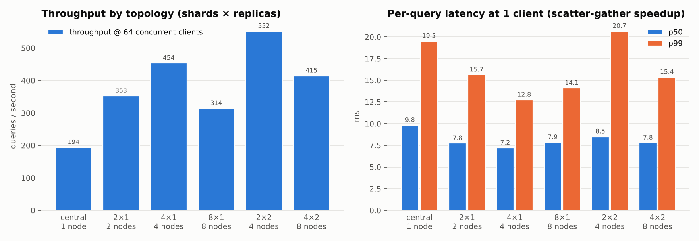
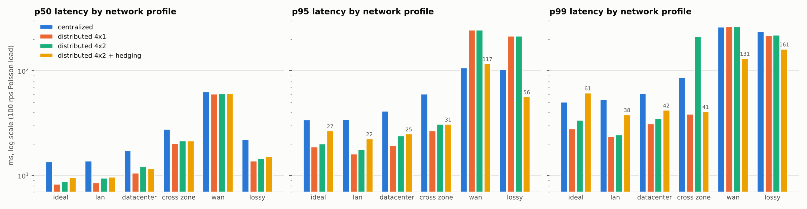
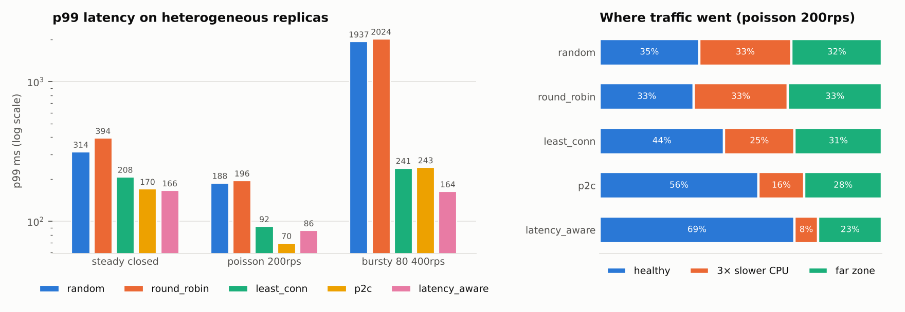
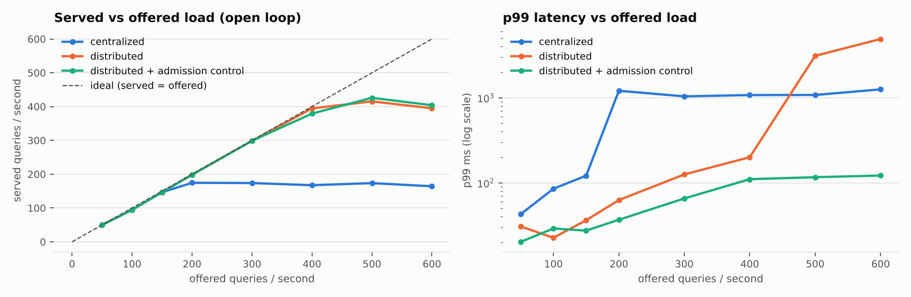
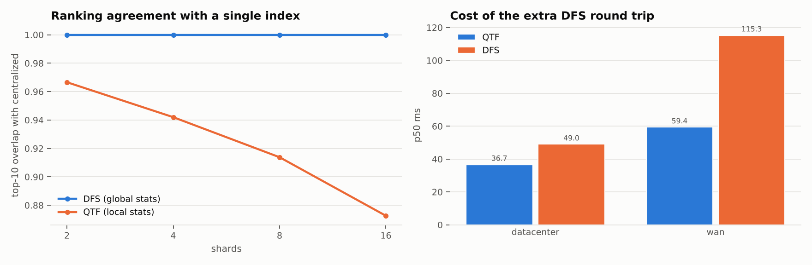
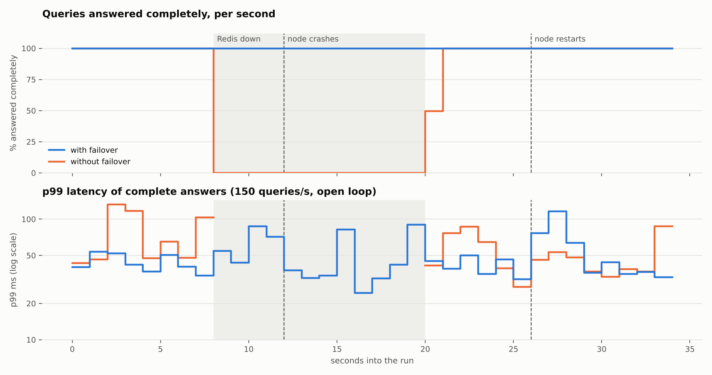

# Benchmark results

Generated by `python -m bench.run_benchmarks` + `python -m bench.plot`. Host: 4 vCPUs, Python 3.13.18; corpus 500,000 docs / 66,205,579 tokens. All services, Redis and the load generator share the same host, so absolute numbers are CPU-bound by that host; relative comparisons are the point.

## Scaling with nodes

| shards | replicas | nodes | clients | rps | p50 ms | p95 ms | p99 ms |
|---:|---:|---:|---:|---:|---:|---:|---:|
| 1 | 1 | 1 | 1 | 96.2 | 9.8 | 16.1 | 19.5 |
| 1 | 1 | 1 | 8 | 187.6 | 41.7 | 59.9 | 72.2 |
| 1 | 1 | 1 | 32 | 185.8 | 170.2 | 209.0 | 241.2 |
| 1 | 1 | 1 | 64 | 194.4 | 312.4 | 362.3 | 386.8 |
| 2 | 1 | 2 | 1 | 121.8 | 7.8 | 11.3 | 15.7 |
| 2 | 1 | 2 | 8 | 321.8 | 23.9 | 36.9 | 47.4 |
| 2 | 1 | 2 | 32 | 367.6 | 85.7 | 107.7 | 124.0 |
| 2 | 1 | 2 | 64 | 353.0 | 177.8 | 219.6 | 243.4 |
| 4 | 1 | 4 | 1 | 132.4 | 7.2 | 10.1 | 12.8 |
| 4 | 1 | 4 | 8 | 375.4 | 20.9 | 30.9 | 35.7 |
| 4 | 1 | 4 | 32 | 429.8 | 75.1 | 102.8 | 124.6 |
| 4 | 1 | 4 | 64 | 453.5 | 139.8 | 192.4 | 219.6 |
| 8 | 1 | 8 | 1 | 121.2 | 7.9 | 11.0 | 14.1 |
| 8 | 1 | 8 | 8 | 277.2 | 27.8 | 41.1 | 50.4 |
| 8 | 1 | 8 | 32 | 307.8 | 102.9 | 151.2 | 166.5 |
| 8 | 1 | 8 | 64 | 314.5 | 199.4 | 287.4 | 349.8 |
| 2 | 2 | 4 | 1 | 109.0 | 8.5 | 13.8 | 20.7 |
| 2 | 2 | 4 | 8 | 394.8 | 19.3 | 32.0 | 39.3 |
| 2 | 2 | 4 | 32 | 558.9 | 54.4 | 87.9 | 103.5 |
| 2 | 2 | 4 | 64 | 552.1 | 109.0 | 175.2 | 217.2 |
| 4 | 2 | 8 | 1 | 120.6 | 7.8 | 11.3 | 15.4 |
| 4 | 2 | 8 | 8 | 334.4 | 22.9 | 36.0 | 48.7 |
| 4 | 2 | 8 | 32 | 408.1 | 75.6 | 118.3 | 145.3 |
| 4 | 2 | 8 | 64 | 415.2 | 150.9 | 222.9 | 263.1 |

## Network conditions

| variant | profile | rps | p50 ms | p95 ms | p99 ms | hedge trigger ms | hedged shard calls |
|---:|---:|---:|---:|---:|---:|---:|---:|
| centralized | ideal | 94.6 | 13.5 | 34.0 | 50.2 | 30.5 | 0 |
| centralized | lan | 94.4 | 13.7 | 34.3 | 53.1 | 31.6 | 0 |
| centralized | datacenter | 94.5 | 17.2 | 41.0 | 60.8 | 37.4 | 0 |
| centralized | cross_zone | 94.4 | 27.7 | 60.0 | 86.4 | 61.7 | 0 |
| centralized | wan | 94.4 | 62.8 | 106.0 | 261.4 | 102.2 | 0 |
| centralized | lossy | 94.4 | 22.1 | 102.8 | 237.4 | 96.6 | 0 |
| distributed 4x1 | ideal | 94.8 | 8.3 | 18.7 | 27.9 | 8.3 | 0 |
| distributed 4x1 | lan | 94.8 | 8.5 | 16.1 | 23.4 | 8.4 | 0 |
| distributed 4x1 | datacenter | 94.8 | 10.5 | 19.5 | 31.0 | 11.7 | 0 |
| distributed 4x1 | cross_zone | 94.5 | 20.4 | 26.6 | 38.4 | 19.4 | 0 |
| distributed 4x1 | wan | 94.2 | 59.7 | 244.2 | 263.8 | 65.3 | 0 |
| distributed 4x1 | lossy | 94.4 | 13.7 | 213.3 | 216.3 | 206.4 | 0 |
| distributed 4x2 | ideal | 94.8 | 8.7 | 20.0 | 33.6 | 10.7 | 0 |
| distributed 4x2 | lan | 94.8 | 9.4 | 17.8 | 24.5 | 9.5 | 0 |
| distributed 4x2 | datacenter | 94.8 | 12.2 | 23.9 | 35.0 | 13.8 | 0 |
| distributed 4x2 | cross_zone | 94.6 | 21.3 | 30.8 | 212.8 | 21.4 | 0 |
| distributed 4x2 | wan | 94.2 | 60.5 | 244.0 | 261.9 | 65.9 | 0 |
| distributed 4x2 | lossy | 94.2 | 14.6 | 214.1 | 217.7 | 37.0 | 0 |
| distributed 4x2 + hedging | ideal | 94.8 | 9.5 | 26.6 | 61.4 | 9.3 | 0.0381 |
| distributed 4x2 + hedging | lan | 94.8 | 9.7 | 22.4 | 38.0 | 10.2 | 0.0565 |
| distributed 4x2 + hedging | datacenter | 94.8 | 11.6 | 24.9 | 42.0 | 11.9 | 0.0505 |
| distributed 4x2 + hedging | cross_zone | 94.5 | 21.3 | 30.9 | 40.7 | 20.9 | 0.053 |
| distributed 4x2 + hedging | wan | 94.4 | 60.2 | 116.6 | 131.0 | 65.8 | 0.0508 |
| distributed 4x2 + hedging | lossy | 94.4 | 15.1 | 56.3 | 160.9 | 50.6 | 0.0622 |

## Load balancing on heterogeneous replicas

2 shards × 3 replicas; per shard r0 = healthy, r1 = 3× slower CPU, r2 = far zone (5 ms ± 2 ms, 0.1% loss).

| workload | strategy | rps | p50 ms | p95 ms | p99 ms | →healthy | →slow CPU | →far zone |
|---:|---:|---:|---:|---:|---:|---:|---:|---:|
| steady_closed | random | 227.2 | 50.7 | 276.2 | 314.4 | 0.331 | 0.339 | 0.33 |
| steady_closed | round_robin | 226.6 | 24.0 | 336.5 | 394.4 | 0.333 | 0.333 | 0.333 |
| steady_closed | least_conn | 433.5 | 37.7 | 154.9 | 207.9 | 0.488 | 0.131 | 0.381 |
| steady_closed | p2c | 459.2 | 44.4 | 111.3 | 170.4 | 0.494 | 0.116 | 0.39 |
| steady_closed | latency_aware | 435.4 | 47.5 | 110.5 | 166.2 | 0.51 | 0.113 | 0.377 |
| poisson_200rps | random | 196.8 | 25.8 | 127.7 | 188.2 | 0.352 | 0.327 | 0.321 |
| poisson_200rps | round_robin | 197.8 | 23.0 | 147.2 | 195.7 | 0.333 | 0.333 | 0.334 |
| poisson_200rps | least_conn | 197.9 | 21.6 | 60.6 | 92.1 | 0.441 | 0.249 | 0.31 |
| poisson_200rps | p2c | 198.4 | 20.6 | 44.9 | 69.8 | 0.562 | 0.162 | 0.276 |
| poisson_200rps | latency_aware | 197.8 | 19.0 | 43.0 | 86.0 | 0.689 | 0.085 | 0.226 |
| bursty_80_400rps | random | 229.6 | 72.8 | 1,776.4 | 1,937.4 | 0.343 | 0.323 | 0.334 |
| bursty_80_400rps | round_robin | 223.2 | 61.1 | 1,912.9 | 2,024.4 | 0.335 | 0.33 | 0.336 |
| bursty_80_400rps | least_conn | 238.2 | 34.7 | 177.2 | 240.6 | 0.457 | 0.185 | 0.358 |
| bursty_80_400rps | p2c | 238.2 | 31.8 | 114.9 | 243.1 | 0.535 | 0.139 | 0.327 |
| bursty_80_400rps | latency_aware | 238.4 | 30.5 | 99.8 | 163.7 | 0.613 | 0.103 | 0.284 |

## Latency vs offered load

| arch | offered rps | served rps | p50 ms | p95 ms | p99 ms |
|---:|---:|---:|---:|---:|---:|
| centralized | 50 | 50.0 | 14.2 | 27.5 | 42.9 |
| centralized | 100 | 94.4 | 17.7 | 50.0 | 85.4 |
| centralized | 150 | 146.5 | 35.7 | 97.4 | 121.4 |
| centralized | 200 | 174.6 | 363.9 | 493.1 | 1,209.0 |
| centralized | 300 | 173.9 | 739.7 | 892.5 | 1,039.2 |
| centralized | 400 | 167.5 | 768.8 | 897.1 | 1,076.5 |
| centralized | 500 | 173.6 | 761.7 | 959.6 | 1,078.6 |
| centralized | 600 | 164.4 | 792.1 | 1,107.5 | 1,255.2 |
| distributed | 50 | 50.0 | 10.5 | 17.2 | 30.7 |
| distributed | 100 | 94.8 | 10.6 | 18.1 | 22.6 |
| distributed | 150 | 146.8 | 10.8 | 22.1 | 36.4 |
| distributed | 200 | 198.4 | 12.0 | 25.4 | 62.8 |
| distributed | 300 | 298.8 | 20.5 | 94.2 | 125.8 |
| distributed | 400 | 394.6 | 55.3 | 158.2 | 200.1 |
| distributed | 500 | 415.4 | 612.3 | 1,772.3 | 3,108.2 |
| distributed | 600 | 395.0 | 786.5 | 1,453.9 | 4,910.4 |
| distributed + admission control | 50 | 50.0 | 10.1 | 15.6 | 20.3 |
| distributed + admission control | 100 | 94.8 | 10.3 | 17.4 | 29.1 |
| distributed + admission control | 150 | 146.8 | 10.5 | 20.7 | 27.5 |
| distributed + admission control | 200 | 198.4 | 12.3 | 28.8 | 36.9 |
| distributed + admission control | 300 | 298.8 | 17.9 | 46.2 | 65.6 |
| distributed + admission control | 400 | 379.2 | 32.4 | 79.5 | 110.5 |
| distributed + admission control | 500 | 426.0 | 49.9 | 92.0 | 116.5 |
| distributed + admission control | 600 | 404.0 | 68.5 | 107.3 | 122.0 |

## Redis result cache

| query popularity | cache | rps | hit rate | p50 ms | p95 ms | p99 ms |
|---:|---:|---:|---:|---:|---:|---:|
| uniform | False | 420.6 | 0 | 76.2 | 109.4 | 135.6 |
| uniform | True | 769.0 | 0.497 | 34.8 | 101.2 | 118.8 |
| zipf_1.1 | False | 456.4 | 0 | 70.6 | 97.7 | 113.0 |
| zipf_1.1 | True | 2,126.2 | 0.887 | 9.4 | 55.9 | 75.8 |

## Ranking quality: local vs global statistics

| shards | QTF overlap@10 | QTF exact top-10 | DFS overlap@10 | DFS exact top-10 |
|---:|---:|---:|---:|---:|
| 2 | 0.967 | 0.32 | 1.0 | 1.0 |
| 4 | 0.942 | 0.106 | 1.0 | 1.0 |
| 8 | 0.914 | 0.024 | 1.0 | 1.0 |
| 16 | 0.873 | 0.02 | 1.0 | 1.0 |

| profile | mode | rps | p50 ms | p95 ms | p99 ms |
|---:|---:|---:|---:|---:|---:|
| datacenter | qtf | 424.9 | 36.7 | 57.1 | 71.3 |
| datacenter | dfs | 312.5 | 49.0 | 74.9 | 90.3 |
| wan | qtf | 209.8 | 59.4 | 247.2 | 260.5 |
| wan | dfs | 109.6 | 115.3 | 308.4 | 330.6 |

## Failure handling: Redis outage and node crash

*Measured separately, later, on a different host (4 vCPUs, Linux-6.18.44-fc-v880-x86_64-with-glibc2.39); compare these numbers within this section.*

4 shards x 2 replicas, 150 queries/s open-loop load. Redis crashes, then a node crashes while Redis is still down; both restart. Same scenario for a router that fails closed (`REDIS_FAILOVER=0`) and one that fails open.

| router | window | requests | answered completely | errors | partial | served degraded | p50 ms | p99 ms |
|---:|---:|---:|---:|---:|---:|---:|---:|---:|
| with failover | steady state | 1177 | 1.0 | 0 | 0 | 0.00255 | 15.8 | 49.4 |
| with failover | Redis down | 604 | 1.0 | 0 | 0 | 1.0 | 15.3 | 77.5 |
| with failover | Redis down + node crashed | 1202 | 1.0 | 0 | 0 | 1.0 | 13.2 | 69.5 |
| with failover | Redis back, node still down | 865 | 1.0 | 0 | 0 | 0.0139 | 15.1 | 45.8 |
| with failover | node restarted | 1210 | 1.0 | 0 | 0 | 0 | 18.8 | 104.3 |
| with failover | whole run | 5058 | 1.0 | 0 | 0 | 0.36 | 15.4 | 78.3 |
| without failover | steady state | 1177 | 1.0 | 0 | 0 | 0 | 19.2 | 106.7 |
| without failover | Redis down | 604 | 0 | 1.0 | 0 | 0 | — | — |
| without failover | Redis down + node crashed | 1202 | 0 | 1.0 | 0 | 0 | — | — |
| without failover | Redis back, node still down | 865 | 0.906 | 0.0936 | 0 | 0 | 15.2 | 77.0 |
| without failover | node restarted | 1209 | 1.0 | 0 | 0 | 0 | 17.5 | 56.9 |
| without failover | whole run | 5057 | 0.627 | 0.373 | 0 | 0 | 17.3 | 97.7 |

- **with failover**: Redis outages seen 1, time degraded 12.045 s, node ejections 4, retries 6
- **without failover**: Redis outages seen 0, time degraded 0.0 s, node ejections 1, retries 4
